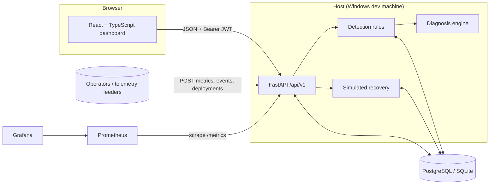

# Architecture

## Data flow
1. Telemetry enters through the API: metric samples, access/app-log events, recorded deployments. Login failures,
   successes and role changes are written by the API itself.
2. `POST /incidents/detect` runs deterministic rules over a time window and creates incidents with **evidence rows**
   (service status, metrics, deployments in the lookback window, application errors, security events). Incidents are
   de-duplicated by `rule:subject` while unresolved.
3. A diagnosis is generated per incident: facts (each traceable to an evidence id) vs. labelled hypotheses.
4. Recovery: `request` (operator) → `approve` (admin ≠ requester) → `execute` (typed confirmation) → simulated
   verification. Every step, including refusals, is written to `audit_logs`.

## Backend modules (`backend/app`)
| Module | Purpose |
|---|---|
| `main.py` | App factory, error handlers, CORS, `/metrics` |
| `api/v1/*` | Routers: auth/users, services/deployments, incidents/events, recovery, audit/dashboard/health |
| `api/deps.py` | DB session, current user, `require_role` |
| `services/detection.py` | Detection rules + correlation |
| `services/diagnosis.py` | Deterministic diagnosis |
| `services/recovery.py` | Allowlist + simulated execution/verification (imports no process/network modules; tested) |
| `services/seed.py`, `cli.py` | Synthetic demo data, user creation |
| `observability.py`, `core/logging.py` | Prometheus metrics, JSON logs with redaction |
| `models/entities.py`, `db/` | SQLAlchemy 2.x models, UTC datetime type |

## Data model
`users`, `services`, `deployments`, `metric_samples`, `security_events`, `incidents` → `evidence`, `diagnoses`,
`recovery_requests`, `audit_logs`. Migrations: `backend/alembic/versions/0001_initial_schema.py`.

## Detection rules (defaults)
| Rule | Trigger | Severity |
|---|---|---|
| brute_force | ≥5 `login_failed` from one IP (or against one account across IPs) within 10 min | high; **critical** if a success follows |
| service_down | last 3 samples all `down` | critical |
| high_error_rate | mean error rate of last ≤5 samples (30 min window, ≥3 samples) > 5% | high; critical ≥ 20% |
| high_latency | mean latency > 1000 ms | medium; high ≥ 2000 ms |
| suspicious_access | ≥10 denied/not-found requests to sensitive paths from one IP in 10 min | medium; high if ≥5 distinct paths |
| privilege_change | any change *to* `admin`; or ≥3 role changes in 10 min | high / critical |

These are simple heuristics, not a complete security product: legitimate admin onboarding will trigger
`privilege_change`.
